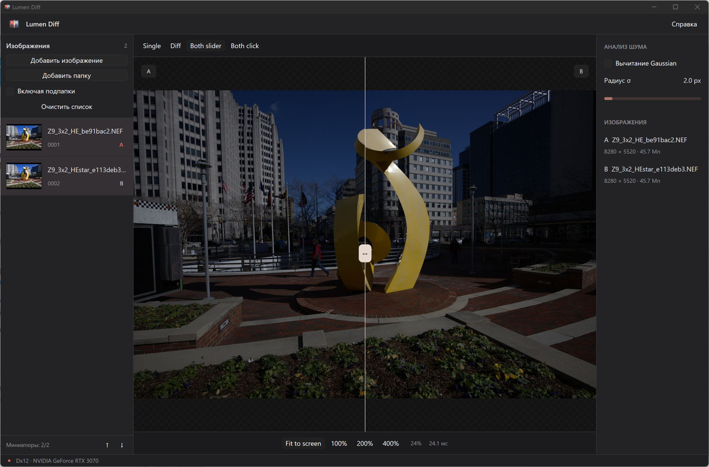
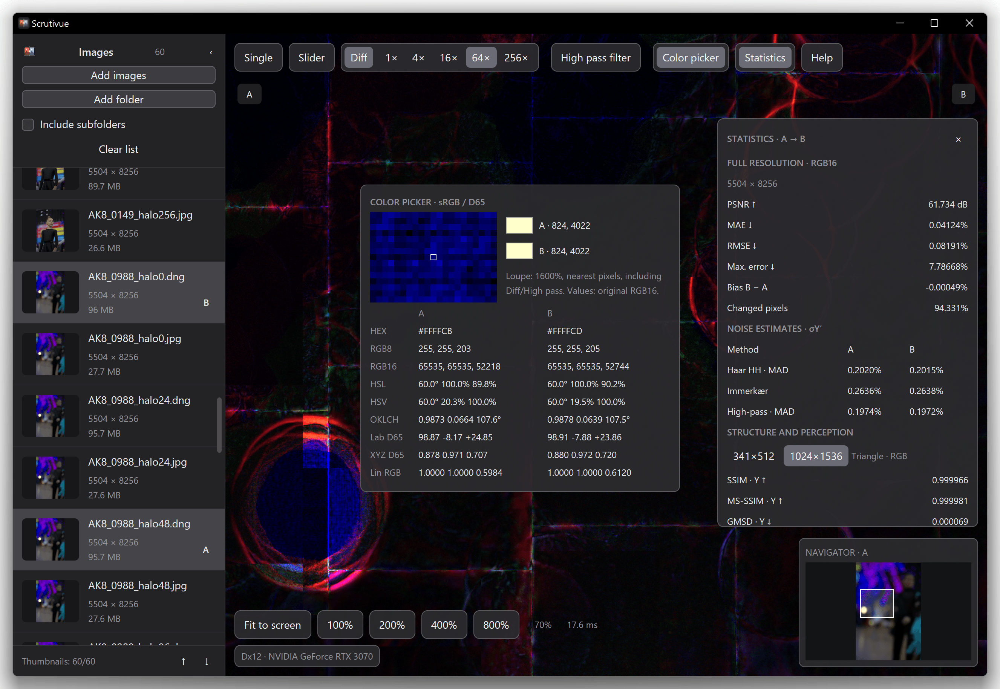

# Scrutivue

[](https://github.com/AlexeyKupershtokh/Scrutivue/actions/workflows/windows.yml)

A desktop application for comparing photographs and RAW images. **Rust · GPUI / GPUI Kit · DX12 through wgpu.** Nikon HE/HE* decoding uses Redlamp's LibRaw fork.



*Synchronized Slider comparison with the image library and navigator.*



*Diff mode with the 1600% color-picker loupe and image statistics.*

- Add files and folders, optionally including subfolders. The virtualized library shows dimensions, readable file sizes (for example, 7.1 MB or 500 KB), background thumbnails and reorderable rows. **Refresh** synchronizes added folders.
- Starts in **Single** with only the first image selected. A normal click selects one image; **Ctrl+click** selects/toggles comparison B. **Slider** and **Diff** are disabled without B; removing B temporarily shows Single and adding it again restores the chosen comparison mode. Context menus offer **Open file**, **Open with**, **Open containing folder**, **Copy file name**, **Copy full path**, and explicit A/B assignment.
- **Single / Slider / Diff** (`1`/`2`/`3`) with tooltips and 1/4/16/64/256× Diff gain. In Single, holding shows B; left and middle dragging pan.
- Separate floating controls of consistent height. Collapse the library to the left ☰ button (`L`); `F11` toggles fullscreen.
- Cursor-anchored zoom from ½ Fit to 800%, with the camera constrained to image edges. Gestures transform a prepared texture; refinement follows 10 ms of inactivity.
- Bottom-right **Navigator** with the visible region: click to recenter, drag its viewport box to pan, or use its wheel to zoom.
- **High pass filter** with a radius control at the top. Cached difference filtering reduces moiré when zoomed out.
- **Color picker** (`C`): an unsmoothed 1600% original-pixel loupe; A/B colors in RGB8/16, HEX, HSL, HSV, OKLCH and Lab/XYZ D65.
- **Statistics** (`S`): progressive results for PSNR, SSIM, MS-SSIM, SSIMULACRA2, GMSD, LPIPS, MAE/RMSE and three separate A/B noise estimates. In-memory LFU caches hold 100 pairs and 20 intermediate resized copies. Completed live-frame hits do not reread files, hash pixels or recompute stages. Streaming resizes and released ONNX activation buffers reduce temporary/retained memory; [measurements and remaining costs](docs/statistics-performance.md). LPIPS uses ONNX + `ort`, without Python.
- JPEG XL DNG 1.7 (RGB/grey16) is decompressed before LibRaw development. DNG DefaultCrop and JPEG orientation are respected without stretching. [DNG/JPEG dimensions](docs/dng.md), [pair loading/cache measurements](docs/loading-performance.md); source files are never changed.
- Supported LinearRaw RGB16 JXL DNGs load both sides simultaneously: Slider starts at the divider and expands left/right; Diff starts at the center and displays differences wherever both tiles are ready. Tiles are reused while panning and returning to recent unfinished images, then completed during idle time. Bundled native decoding can provide an early coarse stage outside Diff. Eligible sources assemble the final RGB16 frame directly from developed tiles without another full LibRaw pass; high-pass and exact tools still wait for a complete, validated frame. [Runtime setup, completion safeguards and progressive test copies](docs/dng-streaming.md).
- View settings, panel visibility and window size persist between sessions.
- Once both frames are loaded, the divider only changes clipping of prepared textures, without recomputing images.
- Add, recursion and clear controls stay above the library; help opens in a separate window (`F1`).

## Build and run

Requires current Rust, Python 3.12+ and a C++17 compiler; on Windows, install Visual Studio Build Tools with the Windows SDK. Preparing the official JPEG XL dependency archive also requires 7-Zip (build-time only).

```powershell
python scripts/prepare.py
python scripts/prepare_jxl_runtime.py --profile release
cargo run --release
cargo run --release -- --recursive "D:\Photos"
cargo run --release -- "D:\Photos\A.NEF" "D:\Photos\B.NEF"
```

The Windows binary is `target/release/scrutivue.exe`; **keep its matching `onnxruntime.dll` and the complete `libjxl/` subdirectory beside it**. Python and 7-Zip are only needed for preparation/validation scripts, not the application. OpenCL is not required. The icon and LPIPS model are embedded in the EXE. The Microsoft Visual C++ x64 runtime may be required on a clean Windows installation.

## Windows builds on GitHub

[Windows workflow](https://github.com/AlexeyKupershtokh/Scrutivue/actions/workflows/windows.yml) runs only when started manually: open **Actions → Windows → Run workflow**. Pushes and pull requests do not trigger builds. It prepares SHA-256-pinned LibRaw/ONNX Runtime/JPEG XL, checks formatting, runs native computation/cache tests, builds Windows x64 release, and checks native tiled DNG decoding and embedded LPIPS through the CLI without a GUI or Python ML dependencies.

Download **Scrutivue-windows-x64** from a successful run's Artifacts section, then extract the included ZIP completely. It contains the application, matching ONNX Runtime, native JPEG XL DLLs and their licenses, build pins and dependency notices. Packaging fails if the pinned JPEG XL runtime or notices are missing or modified. These are unsigned builds, not an installer; Windows SmartScreen may warn. Native GPU/UI tests are run separately on a real desktop, not claimed from the headless CI job.

Comparison is fully offline, with no startup downloads. Formulas, analysis sizes and CLI usage: [metrics](docs/metrics.md). Use `--settings-file "X:\profile\settings.json"` for a separate settings profile.

Details, limitations and validation commands: [manual](docs/manual.md), [measurements](docs/validation.md), [DX12 decision](docs/compute-decision.md). Initial RAW decoding takes seconds in the background; warm GPU measurements do not guarantee input-to-screen latency ≤100 ms on every machine.

Developer-only decoder comparisons and stage timings: [DNG/JPEG XL experiments](docs/dng-jxl-experiments.md).

Manual Windows CI caching, last-run timings and the proposed portable-release process: [CI and releases](docs/ci-and-releases.md).

MIT; LibRaw is used under CDDL-1.0. Notices: [LICENSES](LICENSES/README.md). The Slider overview uses CC0 Nikon Z9 HE/HE* samples from raw.pixls.us. The Diff, color picker and statistics screenshot was provided by the project author. Both show the native application, not an external UI mockup.
